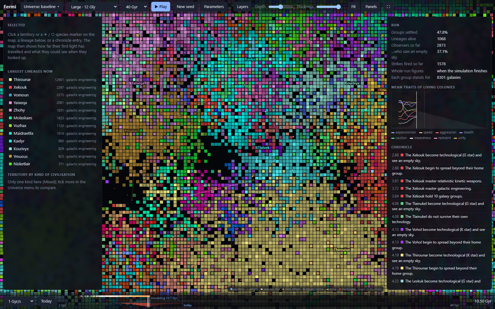
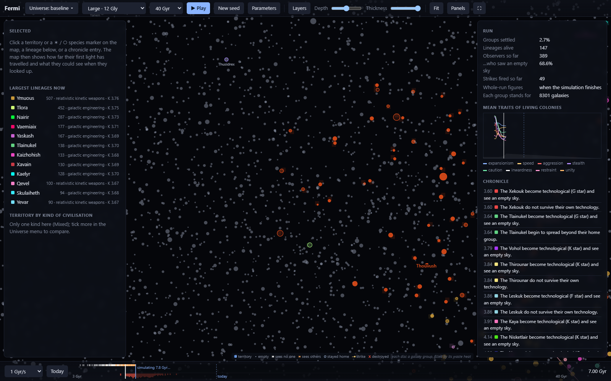
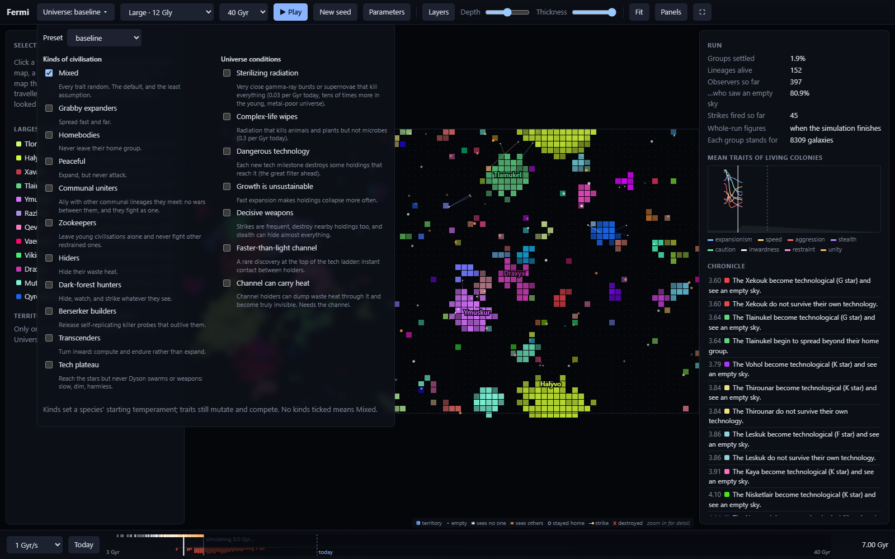

# Fermi

**An evolutionary simulator for the Fermi paradox.** Technological species arise across a
scaled-down sample of the universe, from the Big Bang on. They look at their sky, then die,
stay home or expand, and climb a tech ladder up to Dyson swarms and galactic engineering. The
ones that expand carry a mutating genome of strategy traits, so selection acts on how
civilisations behave.

Every run answers one question: **how many civilisations look up and see nobody, and which
assumptions make that common?**



## What you can do with it

- **Watch a universe unfold live.** Pick which kinds of civilisation can arise and what nature
  is like, press Run, and the simulation streams to the screen as it runs.
- **Zoom from the whole box down to single galaxy groups.** Detail fills in as you go: territory
  shapes far out, then tiles filling with waste heat, then individual groups ringed by owner.
- **Click any species** to see where it arose, what it could actually see when it first looked
  up, how far its first radio light has travelled, and how its traits drifted.
- **Test Fermi explanations as experiments.** Sweep runs from the command line and score which
  settings best explain an observer like us.



## Quick start

```bash
npm install
npm run dev        # viewer at http://localhost:5173
```

```bash
npm run build      # static site in dist/, ready to upload anywhere
```

The whole simulation runs in the browser, so `dist/` needs nothing but a static host, at a
domain root or in a subfolder.

## The viewer

- **Run and play:** Run starts a universe, and playback begins at once, following the
  simulation. The timeline greys out what hasn't been simulated yet. The button then becomes
  Play/Pause, and turns back into Run when you change a setting. New seed runs a fresh universe
  with the same settings.
- **Universe menu:** a preset, plus tick lists of the kinds of civilisation that can arise and
  the conditions of nature.
- **Map:** one copy of the box. When you press Run the box takes the window's shape (same volume
  as the cube the size menu names), so zoomed all the way out it fills the screen between the
  bars, or fits between the panels when they're open. Panning stops at the panels' edges, so
  nothing gets stuck under them. Strikes and rings that cross an edge carry on from the opposite
  one, as the box wraps. Drag to pan, scroll to zoom, hover for detail.
  Depth and Thickness pick a slab of the 3D box to show. Brightness is the share of a group's
  starlight turned to waste heat, on a log scale. A new holding starts dim and brightens as
  settlement spreads through the group and its technology climbs.
- **Selecting:** click a territory, a ✶ (a species becoming technological: white saw an empty
  sky, orange saw someone) or a ○ (a species that stayed home). Lineages and chronicle entries
  are clickable too.
- **Timeline:** settled share in grey, first light as ticks along the top, strikes in red,
  and a marker for today. Click or drag to scrub.
- **Panels:** the selected species (what it saw, what later looks found, its technology, power
  and telescopes), the largest lineages, territory by kind, run statistics, mean traits over
  time, and a chronicle of firsts. Tab hides them.
- **Layers and Parameters:** turn map layers on and off or change the tile size; edit any setting.
- **Full screen:** where the browser refuses full screen (some embedded pages and app panes),
  the button gives the map the whole window instead, hiding the bars and panels; F or Esc
  brings them back.
- **Keys:** Space play/pause · ←/→ step · +/− zoom · 0 fit · Tab panels · F full screen · Esc deselect



## How it works

The model keeps only what matters for who sees whom, and when:

| Level | Modelled | Pruned |
| --- | --- | --- |
| Cosmology | Flat ΛCDM expansion, light travel time, the cosmic event horizon, the history of star formation | Radiation era, local dynamics |
| Universe | A periodic comoving box of galaxy groups with clustering and mass. A cube in the scripts; in the viewer it is stretched to the window's shape at the same volume | Individual galaxies; each group stands for thousands |
| Stars | F, G, K, early-M and late-M stars in their real proportions. Each habitable window is a share of the star's main-sequence lifetime as it brightens: about 3 Gyr for F, 6 for the Sun, 12 for K. M dwarfs outlast the universe so far, but flares and tidal locking are swept as unknowns | Individual stars and planets |
| Biology | Carter's "hard steps" against those windows. A metallicity window: too few metals for rocky planets early on, and too many later, when migrating giant planets wreck inner systems. Gamma-ray bursts follow metal-poor star formation, so the young universe was far more dangerous | Every planet that never produces a technological species: counted analytically, never instantiated |
| Travel | Probes that coast and slow as space expands (momentum ∝ 1/a), with build time rising steeply near light speed | Everything inside a galaxy |
| Civilisations | Filters and collapse. Settlers reach a group's near edge and sweep across it as a front. Each colony takes a build-up time to bootstrap industry and launch onward (the self-copying factory step), charged per galaxy crossed, so expansion speed doesn't depend on how coarse the groups are. Wars are won by energy, with support from neighbouring holdings and attacks from afar both weakened by distance | Individual galaxies' politics |
| Technology | A continuous climb through four milestones: interstellar probes → Dyson swarms → relativistic kinetic weapons → galactic engineering. It smoothly raises probe speed, the share of starlight harnessed (from a thousandth to all of it) and telescope sensitivity. Power is shown as a Kardashev number | Specific inventions |
| Detection | Mid-infrared waste heat of single galaxies on the past light cone. It is judged against a present-day survey: it must be bright enough at its luminosity distance (WISE-class, about 3 Gly for a fully lit galaxy) and a large enough share of starlight (about 10%) to stand out from dust. Species that see nothing look again 10 Myr, 100 Myr and 1 Gyr later with better telescopes. Distances run from where the species lives in its own group to the near edge of each holding's settled galaxies, never closer than the gap between galaxies. Exact within half the box, estimated beyond it from the box's own census | Radio leakage, far too faint to cross between galaxies |
| Time | Event-driven, jumping from one happening to the next | The empty billions of years in between |

Each expanding lineage carries eight traits: **expansionism, speed, aggression, stealth,
caution, inwardness, restraint and unity**. Each has a cost as well as a benefit (see
[src/core/genome.ts](src/core/genome.ts)), and they mutate as colonies spread, so whichever
strategies outcompete the rest take over.

### Explanations enter as experiments, never as switches

A switch such as "everyone stops expanding" just returns whatever was put in. So each Fermi
explanation enters in one of two ways:

- **As an unknown fact of nature, swept as a parameter:** how rare life is, how far waste
  heat can be seen, how dangerous each new technology is.
- **As an option with costs and benefits, which selection can adopt or reject:** stealth,
  strikes, restraint, turning inward. An option can also be removed entirely, to ask whether it
  exists in nature.

An explanation that only produces silence when everyone is forced to follow it counts as
evidence against it. This is Brin's non-exclusivity argument.

| Explanation | Enters as | In the model |
| --- | --- | --- |
| Rare life, Rare Earth | Nature | hard-step rates, habitable planets per solar mass, the metallicity window, M-dwarf flares and tidal locking |
| Radiation hazards | Nature | true sterilization (rare) and complex-life wipes that microbes survive, both worst in the metal-poor young universe |
| We can't see them yet | Nature | how much waste heat stands out from dust; silent species look again with better telescopes |
| Great filter ahead | Nature | risk at each new tech milestone |
| Interstellar travel is hard | Nature | maximum probe speed, launch delay, probes slowing as space expands |
| Growth is unsustainable | Nature | collapse that rises with expansion speed |
| Dark forest | Option + nature | stealth and strikes as options; blast reach and the limits of stealth as nature |
| Berserkers | Kind | some species release self-replicating killer probes that can outlive them |
| Transcension | Option | inwardness: turn inward instead of expanding |
| Zoo, galactic club | Option | restraint: leave young civilisations alone |
| Unification | Option | unity: communal lineages ally rather than fight |
| Technology plateaus | Kind | some species never get past interstellar probes |
| FTL contact, cloaking | Nature | a rare instant channel at the top of the ladder, optionally able to carry away waste heat |
| Percolation (Landis) | Emerges | from expansion mutating and colonies collapsing |

**Kinds of civilisation** set a new species' starting temperament: mixed, grabby expanders,
homebodies, peaceful, communal uniters, zookeepers, hiders, dark-forest hunters, berserker
builders, transcenders and tech plateau. Traits still mutate, and selection decides which
kinds end up with the territory.

**Left out on purpose:** aestivation, whose payoff lies beyond the simulated span, so here it
looks the same as turning inward; the simulation and planetarium hypotheses, which are
unfalsifiable by design; and "they communicate in ways we don't recognise", which is about
alien psychology rather than dynamics.

## Findings so far

These hold within this model and its assumptions. They are not claims about the real universe.

The first is from the latest model, after the resolution fixes described under Robustness.
The next three come from the model just before those fixes: real stars, metal-biased radiation,
coasting probes, calibrated infrared sight and energy-based wars. They rest on two sweeps: 144
universes comparing radiation hazards (4 hard-step rates × 12 seeds each), and 96 across eight
scenarios (4 seeds each). The fixes change how far apart things are seen and how fast settlement
spreads, so those numbers need a re-run. The rest were found with the earlier, simpler model.

- **The verdict doesn't hinge on assumed probe speeds or tech pace.** One question is whether
  assuming particular probe speeds biases the test. To find out, 288 universes crossed hard-step
  rates (10⁻⁴·⁶ to 10⁻⁵·⁸ per Gyr) with each of three expansion assumptions in turn:
  - top probe speed from 0.1c to 0.99c;
  - time per tech milestone from 10 Myr to 1 Gyr;
  - build-up time per galaxy settled, the self-copying factory step, from 10 thousand to 20
    million years.

  Each was scored against our own sky. Everywhere, life as common as 10⁻⁵ or commoner never
  produced an observer like us, so "life must be rare" holds across the whole range. What the
  assumptions do shift is *how* rare. Slow expansion lets life be about 2.5 times commoner
  (10⁻⁵·⁴ rather than 10⁻⁵·⁸), because fewer later species get overrun:
  - at 0.1c, 10⁻⁵·⁴ takes 41% of the self-indication posterior; at 0.9c, 3%;
  - with 20 Myr build-up per galaxy, 44%; with 10 thousand years, 0%.

  Under self-sampling, our sky says nothing about speed, pace or build-up: each stays within
  noise of a flat prior. Tech pace matters least. So bottom-up engineering pays most for the
  expansion rate (launch speed and build-up), which sets the rarity estimate, not the verdict.
  The default and baseline settings were used, at 6 Gly with 30k groups and 6 seeds per setting.
  Counts of observers like us are small (4–187 per setting), so the shares are rough.

- **Either life is rare or the young universe was deadly.**
  - **Without radiation hazards**, life has to be rare. At hard steps of 10⁻⁵ per Gyr or
    commoner, not one of 24 universes produced an observer like us. The baseline's weight sits
    at 10⁻⁵·⁸.
  - **With sterilizing radiation**, it beats no radiation by about 13 to 1 under self-sampling
    and over 100 to 1 under self-indication. Radiation clears the early universe, so life
    arises late and isn't overrun by earlier civilisations.
  - **The metal bias decides how common life can be.** Gamma-ray bursts that follow metal-poor
    star formation are tens of times worse in the young universe than today. With that bias,
    even the commonest life tested (10⁻⁴·⁶) gives many observers like us: 701, and 72% of the
    self-indication posterior. Spread the same radiation over all star formation and that
    setting gives 1. Unbiased radiation only works if life is rarer, near 10⁻⁵.
- **No behavioural explanation replaces those two.** Dark forest, berserkers, a peaceful
  galaxy, unsustainable growth and a filter ahead all score within noise of the baseline
  (5.6–7.3% vs 6.8% under self-sampling).
- **An empty sky is mostly crude telescopes.** About 1–3% of species see nobody at first
  light. Of those that survive to look again a billion years later with better telescopes,
  about 9 in 10 find someone: their neighbours' heat was there all along, but too faint a
  share of starlight to tell from dust.
- **The dark forest doesn't silence the sky.** Partial stealth doesn't protect anyone from
  nearby advanced sensors, so evolution has no gradual slope toward hiding. Strikes are
  attrition that expansion replaces. And the lineages that come to dominate arose before anyone
  was visible, so they never had a reason to hide. Hiding does spread under selection, to a
  stealth of about 0.9, but silence doesn't follow.
- **Fast expansion explains our earliness.** Under self-sampling, fast colonisers preempt most
  later observers, which makes an early observer like us typical. This is Hanson's "grabby
  aliens" argument.
- **The zoo and transcension fail the "everyone must" test.** Restraint and inwardness drift
  rather than rise. Even with an instant FTL channel that lets restrained lineages punish
  attackers, restraint ends no higher. Natives that are left alone see their hosts, so silent
  skies get rarer.
- **"Already here, hidden" almost never happens.** At normal spacing, no silent observer had
  someone in its own galaxy group. With civilisations 2–4 billion light-years apart, about 2% of
  silent observers in dark-forest runs did.
- **At great distances, distance alone silences the sky:** 97–99% silence in every scenario,
  including one with no optional strategies at all.
- **The far future fragments into islands.** Settlement peaks around 30–45 Gyr and then falls.
  Around 100 Gyr, dark energy shrinks the reachable distance below the gap between neighbouring
  groups. After that every group is an island and nothing can be resettled. Nothing in the model
  forces this; it comes from the cosmic event horizon.
- **Our Sun is a ~2% coincidence** (current model). About 89% of present-day technological
  species orbit K dwarfs, because hard steps favour long habitable windows. M dwarfs would win if their
  flares and tidal locking were survivable, which is why both are swept.

## Experiments from the command line

```bash
npm run check        # cosmology and hard-step maths against known values
npm run run          # one universe: chronicle and summary
npm run run -- --json --seed 3 --preemption 0.5
npm run sweep -- --vary hardStepLog10=-5.4,-5.6,-5.8 --vary speedMax=0.1,0.5,0.9 --seeds 8
npm run sweep -- --vary scenario=baseline,berserkers,darkForest --seeds 6
npm run score -- out/sweep-<timestamp>.csv   # which settings best explain an observer like us
```

Any setting in [src/core/params.ts](src/core/params.ts) can be overridden as `--name value`,
and kinds and conditions with `--archetypes a,b` and `--conditions a,b`. Sweeps use all cores
but one (`--jobs N` to change that) and write CSVs to `out/`.

### Scoring against our own sky

`npm run score` rates each setting by how probable an observer exactly like us is under it:
arising within 1 Gyr of 13.8 Gyr, around a G star, with nobody arrived and nothing visible. Two
likelihoods are reported, because anthropic reasoning hasn't settled which applies:

- **SSA (self-sampling):** we are a typical observer; the score is the fraction of observers like us.
- **SIA (self-indication):** we are a typical *possible* observer, so universes with more
  observers like us also score higher.

### Robustness

Present-day silence was checked against things the answer shouldn't depend on. Resolution
(15k–60k groups) and the far-field estimate change it by no more than noise. Box size does
matter: below about 4.5 billion light-years, one empire can fill the box and wrap onto itself,
overstating silence. Scripts default to 6 Gly with 30k groups (about 10 s a run). The viewer's
Large setting uses the volume of a 12 Gly cube with 120k groups (about 50 s), which matches the
converged answer. On a 16:9 window that box is about 18 Gly wide and 10 Gly tall and deep, and
exact sight reaches half its shortest side; the census covers the rest. Small on a very wide
window can dip below the 4.5 Gly floor. These convergence checks were made with the earlier
model and a cube.

**Resolution, re-checked on the current model.** The model used to depend strongly on how
coarse the groups were: very coarse groups made skies about ten times more silent. There were
three causes, all now fixed:
- The nearest settled galaxy was placed a fixed share of the group spacing away. Distances now
  run to the near edge of the settled region.
- The build-up delay was charged once per hop between groups. It is now charged per galaxy
  crossed.
- Settlement spread out from each group's centre, giving natives a head start. It now sweeps
  across from the near edge.

Here is a 6 Gly cube (2 seeds each, after the fixes):

| Groups | Galaxies per group | Empty sky at first light | Observers |
| --- | --- | --- | --- |
| 1,875 | about 132,000 | 1.2–1.7% | 12,900–13,000 |
| 7,500 | about 33,000 | 1.0–1.1% | 6,900–7,800 |
| 30,000 | about 8,300 | 0.7–1.4% | 4,900–5,100 |
| 120,000 | about 2,100 | 0.6–0.8% | 7,000–7,100 |

Silence no longer depends on resolution. Observer counts agree within about 25% from 7,500 to
120,000 groups, a range that takes in both the scripts' default and Large. At the coarsest
setting, which Huge and Vast match, there are still about twice as many observers. Strikes
and wars destroy whole groups, so each hit removes more of the universe when groups are big.
Use Huge and Vast to see scale, and the scripts or Large for numbers. Vast takes about 3
minutes and 1.6 GB.

## Known limits

- Beyond half the box, what observers see is a statistical estimate that treats the box as a
  fair sample of the universe, not a simulation of real neighbours.
- The links between a species' origin and its traits are hypotheses with tunable strength, not findings.
- Strikes and stealth act per galaxy group. Wiping out a lineage's home or whole cluster at
  once isn't modelled, so strikes wear empires down but can't decapitate them. Since a hit
  destroys a whole group, strikes do more damage in coarser runs (see Robustness).
- Every group follows the cosmic mean history of star formation and metals. Real clusters
  formed their stars early and field groups later, which would shift where and when life arises.
- The milestone values (how much starlight each stage harnesses, how good its telescopes are)
  are reasoned guesses, not measurements. Only the present-day survey limits are anchored to data.

## Project layout

| Path | What's there |
| --- | --- |
| `src/core/` | the model: cosmology, universe, biology, genome, tech ladder, kinds, scenarios, the event loop (`sim.ts`) and run summaries |
| `src/cli/` | `run`, `sweep` (parallel), `score` and `check` |
| `src/viewer/` | the browser viewer: map, timeline, panels, and the worker that streams the simulation |
| `scripts/screenshots.ts` | regenerates the images in `docs/` (`npm run screenshots` with the dev server running) |
